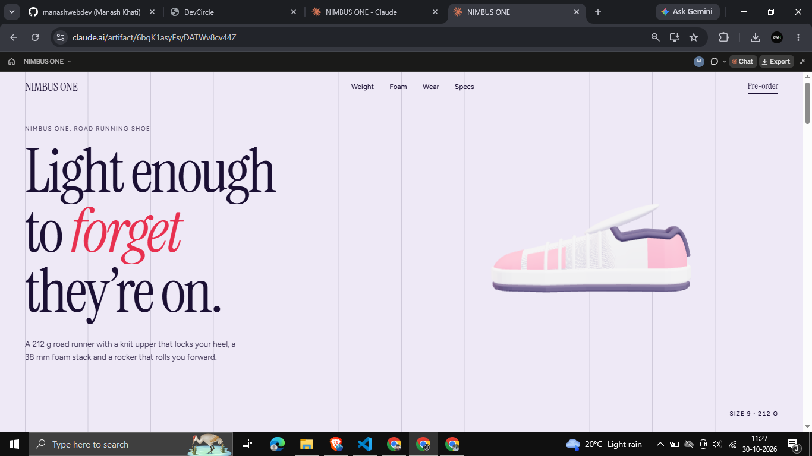
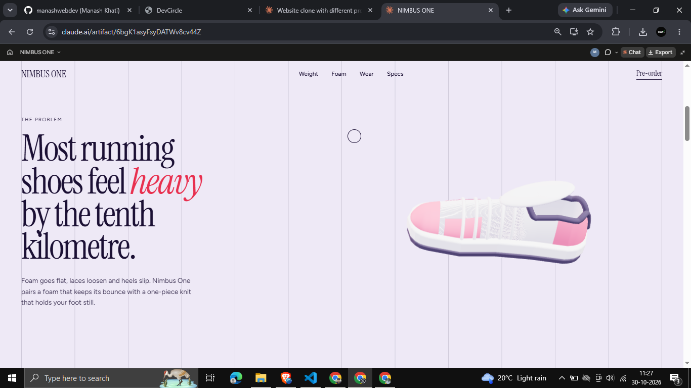
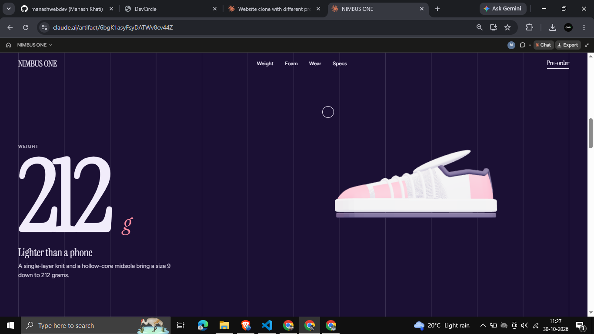
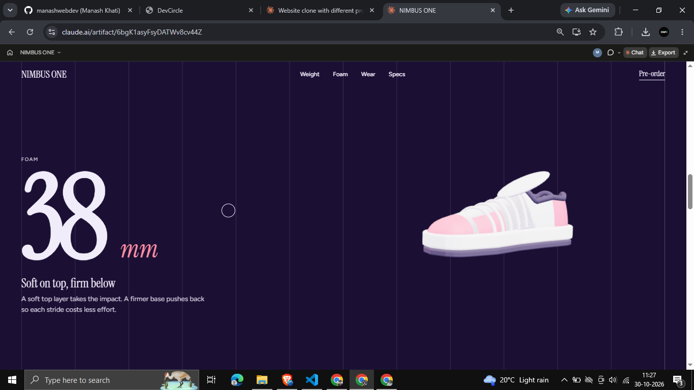
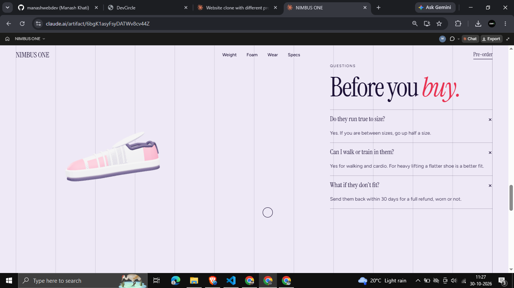
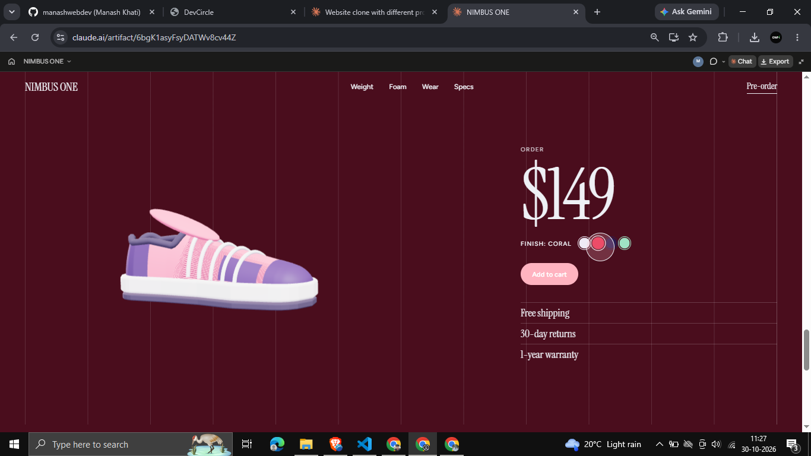
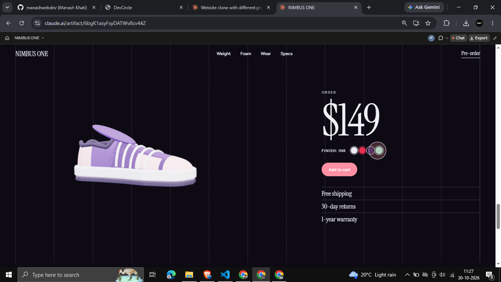

# NIMBUS ONE
hi
Scroll-driven 3D product page for the NIMBUS ONE running sneaker. Three.js, GSAP and Lenis in one HTML file, with a finish picker (Cloud, Coral, Ink, Mint) that recolours the shoe and the page.

## Features
- Procedural 3D sneaker (no model files) built from lofted geometry, with a knit texture
- Smooth scrolling with Lenis; the shoe moves to a new pose in every section
- Page background and accent colours change per section and per finish
- Count-up stats, FAQ accordion, marquee footer, custom cursor
- Responsive, keyboard-focusable, respects reduced motion

## Screenshots
| | |
|---|---|
|  |  |
|  |  |
|  |  |
|  | |

## Run
Open `index.html` in a browser (needs internet for the CDN scripts and fonts), or deploy the folder to Vercel or Netlify.

## Customise
Edit the `FIN` array for finishes and the `P` array for the shoe pose in each section.

## Licence
MIT
